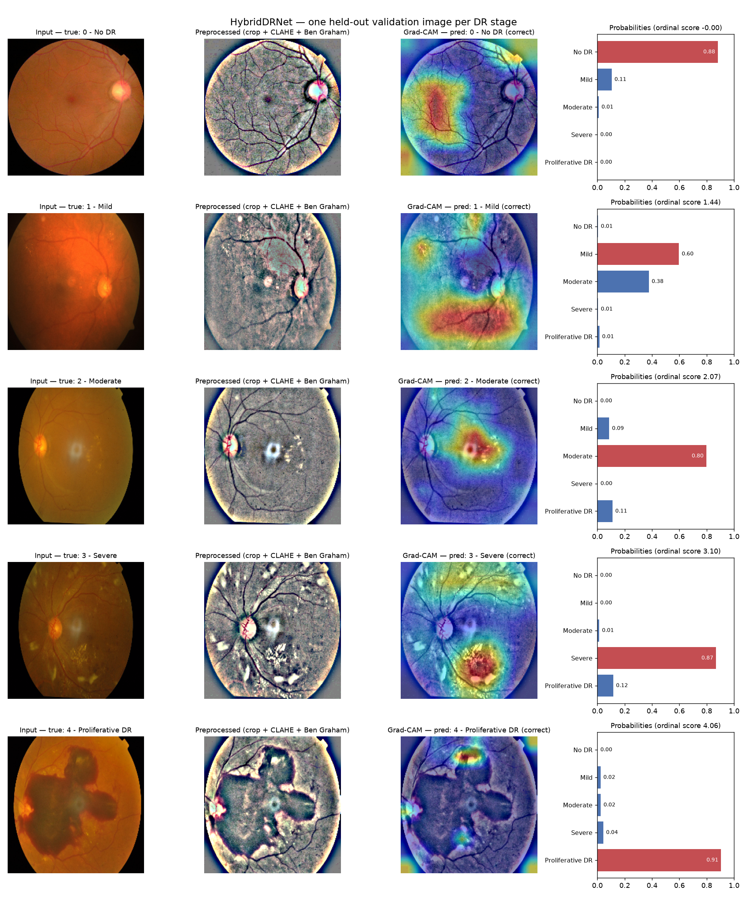
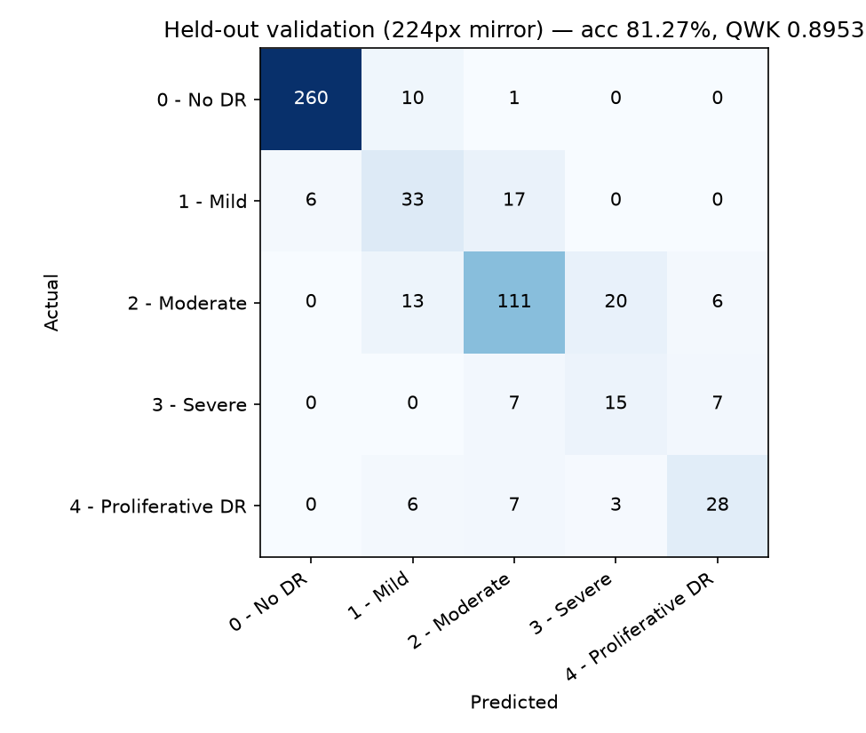

# HybridDRNet — Diabetic Retinopathy Grading

A CNN-Transformer hybrid that grades retinal fundus photographs into the five
diabetic retinopathy (DR) stages. It ships with a **FastAPI** backend, a
**Streamlit** frontend, **Grad-CAM** explanations, the Colab training
notebook, and a research-paper draft.

> **Research prototype only.** This is not a medical device and not a
> substitute for examination by a qualified ophthalmologist.



## Model

- **Backbone:** EfficientNetV2-S (local lesion features).
- **Fusion:** a 4-layer Transformer encoder over the spatial tokens, with a CLS token, for global context.
- **Two heads:** 5-way softmax classification and scalar ordinal regression, trained jointly. Grades are ordered, and the ordinal head targets QWK.
- **Training loss:** focal loss with a class-weighted sampler, on APTOS 2019 (3,662 images, stratified 85/15 split).
- **Inference:** Ben Graham crop, CLAHE, and test-time augmentation (identity, horizontal flip, vertical flip).
- **Explainability:** Grad-CAM on the CNN feature map, taken just before the Transformer fusion.

The checkpoint in `models/best_model.pth` comes from epoch 19 of the first
Colab run (`DR_Training_Colab.ipynb`).

## Results

All numbers are measured, not projected.

| Evaluation | Images | Accuracy | QWK | Macro AUROC | Macro F1 |
|---|---|---|---|---|---|
| Notebook validation split (full resolution, TTA) | 550 | 82.55% | 0.9008 | 0.9386 | 0.681 |
| Same split, rebuilt from a 224px public mirror (TTA) | 550 | 81.27% | 0.8953 | 0.9374 | 0.678 |
| Control: images from the *training* side (224px mirror) | 550 | 94.18% | 0.9735 | 0.9955 | 0.899 |

How the second row was made: the validation split was rebuilt exactly from
[`bumbledeep/aptos`](https://huggingface.co/datasets/bumbledeep/aptos). That
mirror keeps the original `train.csv` order (class counts and leading labels
match), so the same `train_test_split(..., random_state=42)` call yields the
same 550 held-out images.

What the third row shows: the model scores far higher on images it trained on
than on the held-out set. That gap is evidence the held-out images really are
unseen. The small drop from row 1 to row 2 comes from the mirror's 224px
downscaling.

Per-class results on the held-out set (224px mirror):

| Stage | n | Precision | Recall | Specificity | F1 |
|---|---|---|---|---|---|
| 0 - No DR | 271 | 97.7% | 95.9% | 97.8% | 0.968 |
| 1 - Mild | 56 | 53.2% | 58.9% | 94.1% | 0.559 |
| 2 - Moderate | 150 | 77.6% | 74.0% | 92.0% | 0.758 |
| 3 - Severe | 29 | 39.5% | 51.7% | 95.6% | 0.448 |
| 4 - Proliferative DR | 44 | 68.3% | 63.6% | 97.4% | 0.659 |



### One prediction per stage (with Grad-CAM)

Each image is the first validation image of its stage in split order. The
images were fixed before any prediction was made, so they were not chosen
for good results.

| True stage | Predicted | Confidence | Ordinal score | Grad-CAM |
|---|---|---|---|---|
| 0 - No DR | 0 - No DR | 88.2% | 0.00 | [overlay](results/gradcam/stage_0_gradcam.png) |
| 1 - Mild | 1 - Mild | 59.7% (Moderate 38%) | 1.44 | [overlay](results/gradcam/stage_1_gradcam.png) |
| 2 - Moderate | 2 - Moderate | 79.7% | 2.07 | [overlay](results/gradcam/stage_2_gradcam.png) |
| 3 - Severe | 3 - Severe | 86.8% | 3.10 | [overlay](results/gradcam/stage_3_gradcam.png) |
| 4 - Proliferative DR | 4 - Proliferative DR | 90.5% | 4.06 | [overlay](results/gradcam/stage_4_gradcam.png) |

**Five out of five is better than the model's typical result.** Mild and
Severe recall are only about 52–59% across the full held-out set, so the
tables above are the honest measure, not this sample.

**Reading the Grad-CAM maps:**
- **Moderate and Severe:** the maps land on the exudate and lesion clusters.
- **Proliferative DR:** the map concentrates on the edges of the large hemorrhage rather than its centre.
- **No DR:** the map is diffuse, which is expected when there is no lesion.
- **Resolution:** maps are computed at 10×10 and upsampled, so they are coarse.

### Against the literature

QWK 0.90 is on par with Majumder & Kehtarnavaz 2021 (0.90). It sits below
Shaban et al. 2020 (0.91–0.92) and Tymchenko et al. 2020 (0.9255).

Accuracy of 82.6% is below most of the reviewed papers. Several of those
papers use more data, multi-view inputs, or different task definitions, so
the numbers are not directly comparable.

## Quickstart

```bash
python -m venv .venv
```

```bash
.venv\Scripts\activate
```

```bash
pip install torch torchvision --index-url https://download.pytorch.org/whl/cpu
```

```bash
pip install -r requirements.txt
```

The first command runs the backend; the second runs the frontend, each in its own terminal and both from the repository root:

```bash
uvicorn backend.main:app --host 127.0.0.1 --port 8000
```

```bash
streamlit run frontend/streamlit_app.py
```

Open http://localhost:8501. Upload a fundus photo or pick one of the five
sample images. If the API runs somewhere else, set the `BACKEND_URL`
environment variable.

Interactive API docs are at http://127.0.0.1:8000/docs.

### API

| Method | Path | Description |
|---|---|---|
| GET | `/health` | Liveness check, and whether the model is loaded |
| GET | `/model-info` | Classes, input size, checkpoint epoch and validation QWK, device |
| POST | `/predict?gradcam=true` | Multipart `file` (PNG or JPEG, max 20 MB). Returns the grade, label, confidence, per-class probabilities, ordinal score, the preprocessed image, and a Grad-CAM overlay (both base64 PNG) |

```bash
curl -F "file=@samples/stage_2_moderate.png" http://127.0.0.1:8000/predict
```

### Tests

```bash
pytest -v
```

There are 10 tests. They cover health, model info, all five stage samples
(valid probabilities and decodable Grad-CAM images), prediction without
Grad-CAM, and rejection of non-image and empty uploads.

### Reproduce the evaluation and Grad-CAM figures

```bash
python scripts/run_sample_predictions.py
```

This downloads the roughly 250 MB APTOS mirror into `.cache/`, rebuilds the
validation split, and evaluates it together with the training-side control.
It then writes everything to `results/` and `samples/`.

## Repository layout

```
dr_model.py                  model, preprocessing, losses, Grad-CAM, checkpoint loading
inference.py                 DRPredictor: preprocessing + TTA prediction + Grad-CAM overlay
backend/main.py              FastAPI app
frontend/streamlit_app.py    Streamlit UI (talks to the backend over HTTP)
models/best_model.pth        trained checkpoint (epoch 19)
scripts/run_sample_predictions.py   held-out evaluation + per-stage Grad-CAM
samples/                     one held-out validation image per stage
results/                     metrics JSON, confusion matrix, Grad-CAM figures
tests/test_api.py            API tests
DR_Training_Colab.ipynb      training notebook (Colab GPU)
paper/                       research paper draft
```

## Training

To train, open `DR_Training_Colab.ipynb` in Google Colab on a GPU runtime and
run it top to bottom. It downloads APTOS 2019 through the Kaggle API.

The current notebook adds MixUp, EMA weights, QWK-optimized thresholds and an
optional 5-fold ensemble. The shipped checkpoint was trained **before** those
upgrades. `dr_model.remap_legacy_state_dict` lets it load into the current
architecture, and inference is numerically identical.

## Data and licensing

- **Training data:** APTOS 2019 Blindness Detection (Kaggle competition data).
- **Sample images:** taken from the MIT-licensed
  [`bumbledeep/aptos`](https://huggingface.co/datasets/bumbledeep/aptos) mirror.
